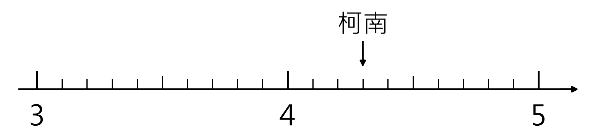
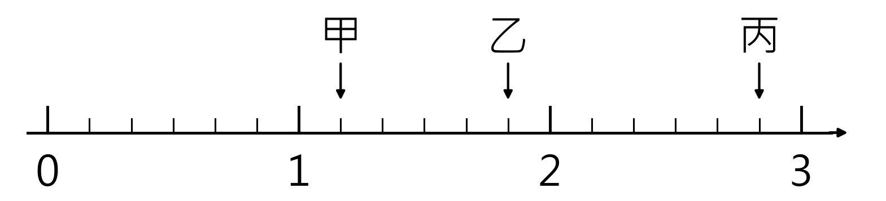
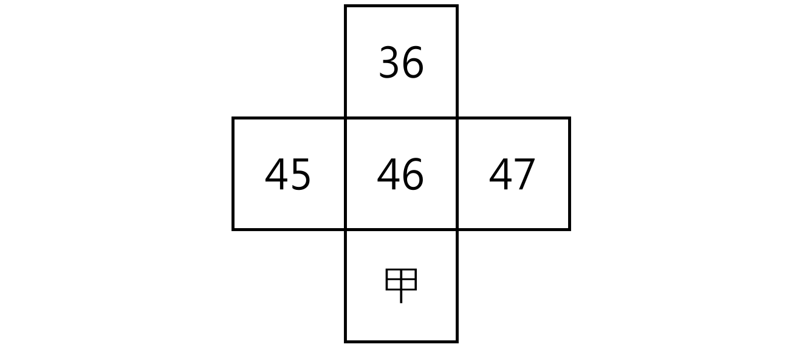
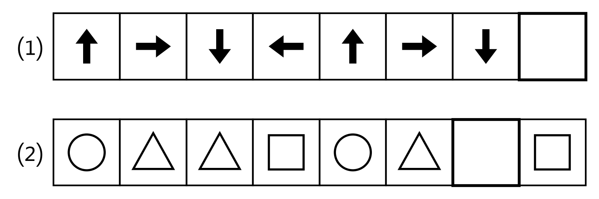
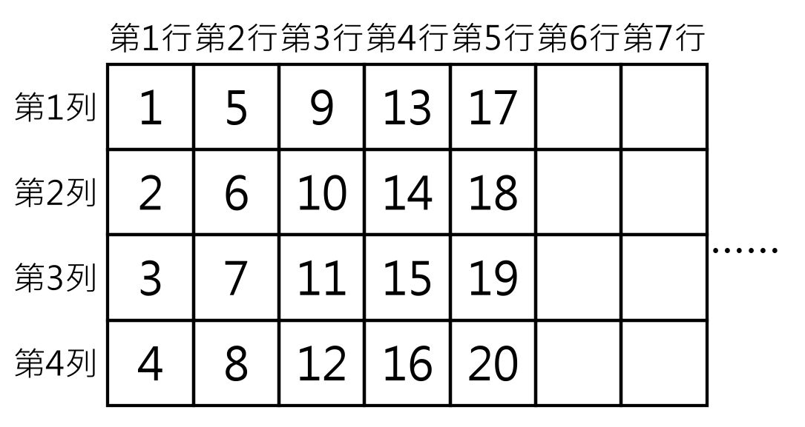
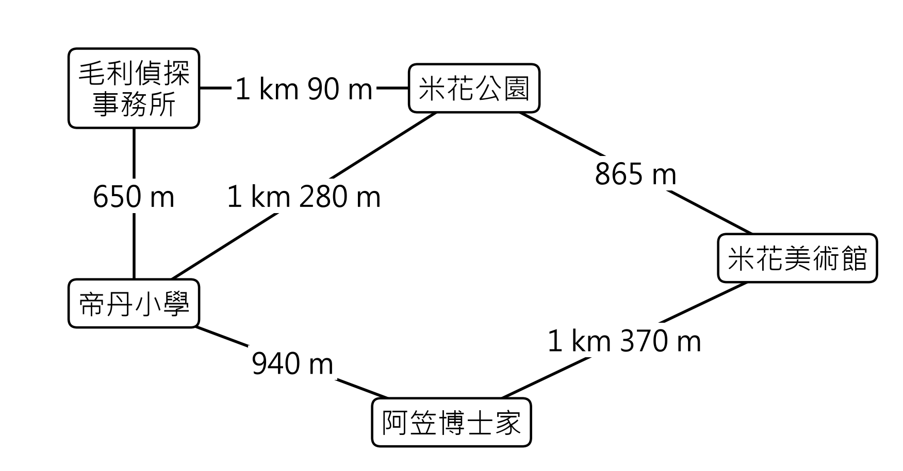

<!--
【阿穎備註，不會印出來】
範圍：南一版四上第 6～10 單元（課本第 82～149 頁）。加油小站 2、數學探索不考。
主題：名偵探柯南（怪盜基德的預告信，偷寶石、解密碼、追蹤路線，沒有暴力內容）。四年級不加注音。
每題答案都用 Python 算過。數字和情境都和課本、習作不同。
圖 6 張在 題庫/圖/數學四上期末_*.png，要改圖就改 題庫/圖/數學四上期末_畫圖.py 再執行一次。

【雙向細目表】（格內為題號，括號內為配分）
| 單元 | 記憶 | 理解 | 高層次（挑戰、素養） | 小計 |
|---|---|---|---|---|
| 第六單元 分數 | （一）1、（二）1、（五）1 兩格、（五）2（10） | （二）2、（五）3、（五）4 三格（10） | — | 20 |
| 第七單元 數量關係 | （一）2（2） | （二）3、4、（五）5 兩格、（五）6、（七）兩格（14） | （八）1、2 素養（4） | 20 |
| 第八單元 整數四則 | （一）3（2） | （二）5、6、（四）1、2、（六）1、2（18） | — | 20 |
| 第九單元 小數 | （一）4、（五）7（4） | （二）7、8、（三）1、2、（五）8（12） | （六）4 挑戰題（4） | 20 |
| 第十單元 長度 | （一）5、（二）9、（五）9、10（8） | （二）10、（六）3（6） | （八）3、4 素養（6） | 20 |
| 合計 | 26 | 60 | 14 | 100 |

較難題共 14 分：素養題（八）1～4 共 10 分（讀寄物櫃號碼圖、讀地圖），挑戰題（六）4 共 4 分（「比…短」要用加法，還要把公分換成公尺）。
其中（八）2（46 號在第幾行第幾列）最難；（二）6、（五）6 是中間偏難。
題型：是非、選擇、直式計算、算算看、填填看、應用題、畫畫看、素養題，共 8 大題。
題數：是非 5、選擇 10、直式 2、算算看 2、填 14 格、應用 4、畫 2 格、素養 4 小題。預估一般程度約 38～42 分鐘。
選擇題答案分布：① 2 題、② 3 題、③ 3 題、④ 2 題。是非題：○ 3、× 2。
-->

> 怪盜基德寄來預告信，說今晚要偷走米花美術館的寶石「藍色星光」。
> 柯南和少年偵探團要解開八道關卡，才能守住寶石。請你一起來幫忙！

## 一、是非題（線索真偽判斷）：每題 2 分，共 10 分

對的打○，錯的打×。

1. 光彥說：「{{9/9}} 的分子和分母一樣大，所以 {{9/9}} 是真分數。」
   答: ×
   解析: 分子和分母一樣大的分數是假分數，{{9/9}}＝1。（課本第 85 頁）

2. 步美說：「保險箱的密碼是 135×47 的積，這個積是奇數。」
   答: ○
   解析: 奇數×奇數的積是奇數，135×47＝6345。（課本第 105 頁）

3. 元太說：「算 60－24÷6 的時候，要先算 60－24。」
   答: ×
   解析: 沒有括號時先乘除後加減，要先算 24÷6＝4，再算 60－4＝56。（課本第 118 頁）

4. 灰原說：「5.92 的 2 在百分位，表示 2 個 0.01。」
   答: ○
   解析: 課本第 127 頁。

5. 阿笠博士說：「1 公里等於 100000 公分。」
   答: ○
   解析: 1 公里＝1000 公尺，1 公尺＝100 公分，1000×100＝100000。（課本第 143 頁）

## 二、選擇題（找出正確答案）：每題 2 分，共 20 分

1. 基德的預告信上寫著：4＝{{□/7}}。□ 裡的數是多少？
   ①4　②11　③28　④47
   答: ③
   解析: 1 是 {{7/7}}，4 是 7×4＝28 個 {{1/7}}，所以 4＝{{28/7}}。②是 4＋7，④是把 4 和 7 並排。（課本第 87 頁）

2. 1 條吐司平分成 6 片。少年偵探團共吃了 17 片，是幾條吐司？
   ①{{6/17}} 條　②{{2 5/6}} 條　③{{5 2/6}} 條　④{{1 7/6}} 條
   答: ②
   解析: 17 片是 {{17/6}} 條，17÷6＝2…5，所以是 {{2 5/6}} 條。①分子分母寫反，③商和餘數寫反。（課本第 89 頁）

3. 2026 年 12 月 3 日是星期四。基德預告在同一年的 12 月 24 日行動，這一天是星期幾？
   ①星期三　②星期四　③星期五　④星期六
   答: ②
   解析: 月曆同一直排相鄰的數都相差 7。3＋7＝10、10＋7＝17、17＋7＝24，所以 24 日和 3 日一樣是星期四。（課本第 98 頁）

4. 下面哪一個算式的答案是奇數？
   ①246＋138　②357＋481　③124×35　④573－218
   答: ④
   解析: 奇數－偶數＝奇數（573－218＝355）。①偶＋偶＝偶，②奇＋奇＝偶，③偶×奇＝偶。（課本第 103～105 頁）

5. 3 個紅豆麵包賣 96 元，1 瓶牛奶賣 28 元。元太買 1 個紅豆麵包和 1 瓶牛奶，共要付幾元？下面哪一個算式是對的？
   ①96÷3＋28　②（96＋28）÷3　③96＋28÷3　④96×3＋28
   答: ①
   解析: 先算 1 個麵包 96÷3＝32 元，再加牛奶 28 元，共 60 元。（課本第 119 頁）

6. 下面哪一個算式的答案和 80÷（5×2）一樣？
   ①80÷5×2　②80÷5÷2　③80×5÷2　④80÷5＋2
   答: ②
   解析: 80÷（5×2）＝80÷10＝8。②80÷5÷2＝16÷2＝8。①是 32，③是 200，④是 18。（課本第 115 頁）

7. 柯南在下圖數線上箭頭的位置。他往左移 6 小格，會停在哪一個數？
   
   ①4.9　②4.24　③3.7　④3.3
   答: ③
   解析: 每 1 小格是 0.1，箭頭在 4.3，4.3－0.6＝3.7。①是往右移，②把 1 小格當成 0.01。（課本第 135 頁）

8. 目暮警官記錄了四個人的身高，誰最高？
   ①毛利小五郎 1.7 公尺　②小蘭 1.68 公尺　③步美 1.07 公尺　④園子 1.69 公尺
   答: ①
   解析: 個位都是 1，再比十分位，1.7 的十分位是 7 最大。1.7＝1.70＞1.69＞1.68＞1.07。（課本第 130 頁）

9. 下面哪一個長度最接近 1 公里？
   ①柯南的身高
   ②教室黑板的長度
   ③一棟 10 層樓房的高度
   ④在 1 圈 200 公尺的操場跑道上走 5 圈的路程
   答: ④
   解析: 200×5＝1000 公尺＝1 公里。（課本第 140 頁）

10. 警車先開了 2 km 650 m，又開了 1 km 480 m，共開了多遠？
    ①3 km 130 m　②4 km 30 m　③4 km 130 m　④5 km 130 m
    答: ③
    解析: 2650＋1480＝4130，4130 m＝4 km 130 m。①忘了把 1000 m 進位成 1 km。（課本第 144 頁）

## 三、用直式算算看（破解密碼鎖）：每題 3 分，共 6 分

1. 3.47＋5.86＝（　　　　）
   答: 9.33
   解析: 小數點要對齊，百分位、十分位都要進位。（課本第 131 頁）
<留白 7>

2. 12－4.65＝（　　　　）
   答: 7.35
   解析: 12 記成 12.00 再減，小數點要對齊。（課本第 132 頁）
<留白 7>

## 四、算算看（寫出計算過程）：每題 3 分，共 6 分

1. 500－36×12
   答: 68
   解析: 500－36×12＝500－432＝68。先乘除後加減。過程 2 分、答案 1 分。（課本第 118 頁）
<留白 6>

2. 384÷（20－8）
   答: 32
   解析: 384÷（20－8）＝384÷12＝32。有括號的先算。過程 2 分、答案 1 分。（課本第 117 頁）
<留白 6>

## 五、填填看（偵探筆記）：每格 2 分，共 28 分

1. 把帶分數換成假分數：{{3 4/9}}＝（　　　　）
   把假分數換成帶分數：{{38/7}}＝（　　　　）
   答: {{31/9}}；{{5 3/7}}
   解析: 9×3＋4＝31；38÷7＝5…3。（課本第 88、89 頁）

2. 19 個 {{1/6}} 是（　　　　）。（用假分數表示）
   答: {{19/6}}
   解析: 課本第 84 頁。

3. 1 盒偵探徽章有 8 個，{{29/8}} 盒也可以說是（　　　　）盒。（用帶分數表示）
   答: {{3 5/8}}
   解析: 29÷8＝3…5。（課本第 89 頁）

4. 看下圖的數線，甲、乙、丙各是多少？
   
   甲＝（　　　　）（用假分數表示）
   乙＝（　　　　）（用帶分數表示）
   丙＝（　　　　）（用假分數表示）
   答: 甲 {{7/6}}；乙 {{1 5/6}}；丙 {{17/6}}
   解析: 0 到 1 平分成 6 格，每 1 格是 {{1/6}}。甲是 1 往右 1 格，乙是 1 往右 5 格，丙是 2 往右 5 格（2＝{{12/6}}）。（課本第 90、91 頁）

5. 密碼鎖上的數有規律，把（　）裡的數填出來。
   ⑴ 4、11、18、25、（　　　　）、39
   ⑵ 95、86、77、68、（　　　　）
   答: ⑴ 32；⑵ 59
   解析: ⑴每次加 7。⑵每次減 9。（課本第 96、97 頁）

6. 下圖是百數表的一小塊，甲是（　　　　）。
   
   答: 56
   解析: 百數表每往下一格加 10，46＋10＝56。（課本第 97 頁）

7. 205 個 0.01 是（　　　　）。
   答: 2.05
   解析: 200 個 0.01 是 2，5 個 0.01 是 0.05。（課本第 128、129 頁）

8. 灰原用捲尺量出窗戶的寬是 1 公尺 7 公分，也就是（　　　　）公尺。
   答: 1.07
   解析: 1 公分是 0.01 公尺，7 公分是 0.07 公尺。寫成 1.7 是錯的。（課本第 126 頁）

9. 6 公里 45 公尺＝（　　　　）公尺
   答: 6045
   解析: 6 公里＝6000 公尺，6000＋45＝6045。寫成 6450 或 645 是錯的。（課本第 142 頁）

10. 7080 m＝（　　　　）km（　　　　）m　（兩個都對才給分）
    答: 7；80
    解析: 7000 m＝7 km，還有 80 m。（課本第 142 頁）

## 六、把做法用算式記下來（偵探出任務）：每題 4 分，共 16 分

1. 阿笠博士買了 18 個指紋採集盒和 12 個放大鏡，每個都賣 35 元，共要付幾元？（把做法用一個算式記下來）
   答: 35×（18＋12）＝35×30＝1050　答：1050 元
   解析: 也可以列 35×18＋35×12＝630＋420＝1050。算式 2 分、計算 1 分、答（含單位）1 分。（課本第 116 頁）
<留白 6>

2. 少年偵探團有 500 元，買追蹤器的電池用掉 148 元，剩下的錢剛好可以買 8 枝螢光筆。1 枝螢光筆賣幾元？（把做法用一個算式記下來）
   答: （500－148）÷8＝352÷8＝44　答：44 元
   解析: 先算剩下的錢，要加括號。算式 2 分、計算 1 分、答（含單位）1 分。（課本第 117 頁）
<留白 6>

3. 柯南踩著滑板繞米花公園 4 圈，共滑了 5 公里 200 公尺。米花公園 1 圈長幾公里幾公尺？
   答: 5 公里 200 公尺＝5200 公尺，5200÷4＝1300，1300 公尺＝1 公里 300 公尺　答：1 公里 300 公尺
   解析: 先換成公尺再除。算式 2 分、計算 1 分、答（含單位）1 分。（課本第 147 頁）
<留白 6>

4. ★挑戰題：光彥的繩子長 3.2 公尺，比元太的繩子短 65 公分。元太的繩子長幾公尺？
   答: 65 公分＝0.65 公尺，3.2＋0.65＝3.85　答：3.85 公尺
   解析: 光彥的比較短，所以元太的比較長，要用加法；65 公分要先換成 0.65 公尺。換算 1 分、算式 1 分、計算 1 分、答（含單位）1 分。（課本第 126、133 頁）
<留白 6>

## 七、畫畫看（基德的圖形密碼）：每格 2 分，共 4 分

1. 基德留下兩排有規律的圖形。看下圖，在⑴、⑵粗線的空格裡畫出正確的圖形。
   
   答: ⑴ 向左的箭頭（←）；⑵ 三角形（△）
   解析: ⑴「上、右、下、左」每 4 個重複一次。⑵「○、△、△、□」每 4 個重複一次。（課本第 101 頁）

## 八、素養題（守住寶石的最後關卡）：共 10 分

### （一）美術館的寄物櫃

下圖是米花美術館的寄物櫃，每一行有 4 個櫃子。號碼從第 1 行開始，由上到下排，排完再換右邊一行，後面的櫃子也照這個規律排下去。

1. 第 4 列的號碼是 4、8、12、16……。第 9 行、第 4 列的寄物櫃是幾號？（2 分）
   （　　　　）號
   答: 36
   解析: 第 4 列的號碼每次加 4，第 9 行是 4×9＝36。

2. 基德把下一張預告信藏在 46 號寄物櫃。46 號在第幾行、第幾列？（2 分，兩個都對才給分）
   第（　　　　）行、第（　　　　）列
   答: 第 12 行、第 2 列
   解析: 46÷4＝11…2。前 11 行排到 44 號，46 號在第 12 行，由上往下數第 2 個，所以是第 2 列。（課本第 99 頁）
<留白 3>

### （二）趕往美術館

下圖是米花町的地圖，線上的數字是兩個地點之間的路程。

3. 柯南從帝丹小學出發，經過米花公園到米花美術館，共走了幾公里幾公尺？（3 分）
   答: 1 km 280 m＋865 m＝2 km 145 m　答：2 公里 145 公尺
   解析: 1280＋865＝2145，2145 m＝2 km 145 m。算式 1 分、計算 1 分、答（含單位）1 分。（課本第 145 頁）
<留白 5>

4. 少年偵探團從帝丹小學出發，經過阿笠博士家到米花美術館。柯南和少年偵探團，誰走的路比較短？短幾公尺？（3 分）
   答: 940 m＋1 km 370 m＝2 km 310 m，2310－2145＝165　答：柯南走的路比較短，短 165 公尺
   解析: 少年偵探團走 940＋1370＝2310 公尺，柯南走 2145 公尺。算出少年偵探團的路程 1 分、相差 1 分、答（誰、幾公尺都對）1 分。（課本第 145 頁）
<留白 6>

【寫完請記得檢查喔!】
